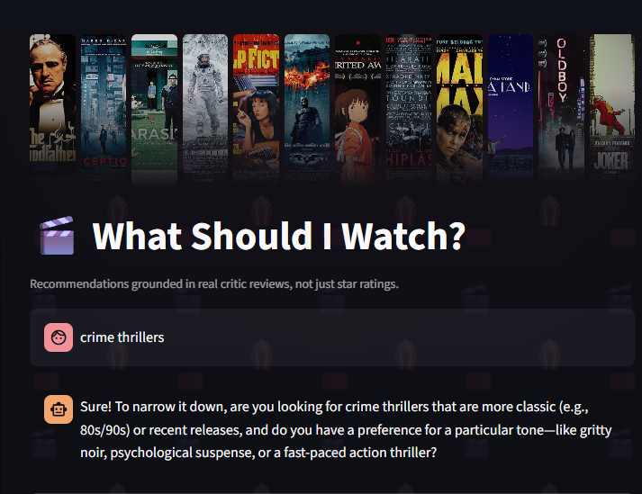
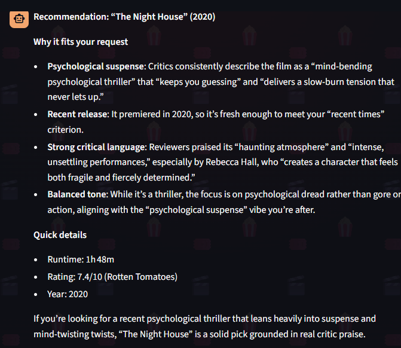
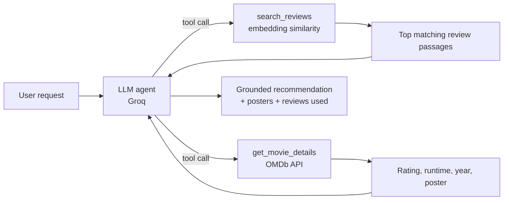

# 🎬 Reelwise: Movie & Series Recommendation Agent

An agentic RAG app that recommends what to watch based on **what critics actually wrote**, not just star ratings. Describe a mood ("something warm after a rough week") and the agent retrieves matching review passages, checks live details from OMDb, and explains its pick using the retrieved reviews.

[](https://movie-recommendation-agent-gr3mvyxqhphj9jmjfr6jqh.streamlit.app/)

**Live app:** https://movie-recommendation-agent-gr3mvyxqhphj9jmjfr6jqh.streamlit.app/
(Free-tier apps sleep when idle. If you see a "wake up" button, click it and wait about a minute.)




## Why this exists

A rating of 7.9 tells you people liked a film. It doesn't tell you whether it's slow, sad, funny or strange. Reelwise matches your words to the language reviewers use and shows the review text behind each recommendation.

## How it works



1. **Retrieve:** the query is embedded with `all-MiniLM-L6-v2` and compared (cosine similarity) against precomputed review embeddings. Results are de-duplicated and capped at 2 reviews per title so one movie can't dominate.
2. **Reason:** a tool-calling LLM on Groq (`openai/gpt-oss-20b`) decides when to search reviews and when to look up a title.
3. **Look up:** OMDb supplies the IMDb rating, runtime, year and poster.
4. **Answer:** the model writes a recommendation that quotes the retrieved review language. On the final turn tools are disabled, so the agent always produces an answer.

If the request is vague, the agent asks one clarifying question before recommending.

## Tech stack

| Part | Choice |
|---|---|
| UI | Streamlit |
| LLM | Groq API, `openai/gpt-oss-20b` (open-weight model served by Groq) |
| Embeddings | `sentence-transformers` (`all-MiniLM-L6-v2`) |
| Retrieval | NumPy cosine similarity over precomputed embeddings |
| Movie data | OMDb API |
| Language | Python |

## Project structure

```
app.py                    # Streamlit UI, agent loop, tools
review_embeddings.npy     # precomputed review embeddings
review_data.pkl           # review text + metadata (title, review type)
requirements.txt
```

## Run it locally

```bash
git clone https://github.com/SreejayaT/movie-recommendation-agent.git
cd movie-recommendation-agent
python -m venv venv
source venv/bin/activate        # Windows: venv\Scripts\activate
pip install -r requirements.txt
```

Create `.streamlit/secrets.toml` (never commit this file):

```toml
GROQ_API_KEY = "your_groq_key"
OMDB_API_KEY = "your_omdb_key"
```

Then start the app:

```bash
streamlit run app.py
```

Free keys: [Groq](https://console.groq.com/keys) and [OMDb](https://www.omdbapi.com/apikey.aspx).

## Deploying on Streamlit Community Cloud

1. Push the repo to GitHub.
2. On [share.streamlit.io](https://share.streamlit.io), create an app from the repo with `app.py` as the main file.
3. Add `GROQ_API_KEY` and `OMDB_API_KEY` under **Advanced settings → Secrets**.

## Limitations

- Recommendations only cover titles present in the review dataset.
- Retrieval is plain cosine similarity with no re-ranking, so very short or vague queries can return loosely related reviews.
- Groq's free tier has rate limits, and Groq retires models from time to time. If the app returns a 404, check the model name in `app.py`.
- OMDb's free tier allows 1,000 requests per day.

## Ideas for next steps

- Sidebar filters (movie vs series, minimum rating, runtime)
- Re-ranking retrieved reviews before generation
- Evaluation set to measure how well picks match the requested mood

## Author

Built by **Sreejaya**. Showcase page: add your GitHub Pages link here.
